 

---

## 🧠 &nbsp;About Me

> **Aspiring Software Developer** focused on **Java** and **web development**.
> I build full-stack apps and learn best by shipping real projects.

---

## ⚡ &nbsp;Tech Stack

---

## 🚀 &nbsp;Featured Projects

<table>
  <tr>
    <td width="50%" valign="top">
      <h3>🚚 <a href="https://github.com/SatyajitManna4/truck-singh-demo">truck-singh-demo</a></h3>
      
Logistics platform with role-based dashboards for shippers, drivers, owners, agents &amp; admin.

      
      
    </td>
    <td width="50%" valign="top">
      <h3>💞 <a href="https://github.com/SatyajitManna4/Plan-and-pair-matrimonial-Apps">Plan-and-Pair</a></h3>
      
Matrimony / matchmaking style application built in Java.

      
      
    </td>
  </tr>
  <tr>
    <td width="50%" valign="top">
      <h3>🌦️ <a href="https://github.com/SatyajitManna4/Weather-app">Weather-app</a></h3>
      
Clean weather-checking website powered by JavaScript.

      
      
    </td>
    <td width="50%" valign="top">
      <h3>🎨 <a href="https://github.com/SatyajitManna4/Satyajit-Portfolio">Satyajit-Portfolio</a></h3>
      
My personal portfolio website.

      
      
    </td>
  </tr>
</table>

---

## 📊 &nbsp;GitHub Stats

  

---

## 🤝 &nbsp;Let's Connect

  

